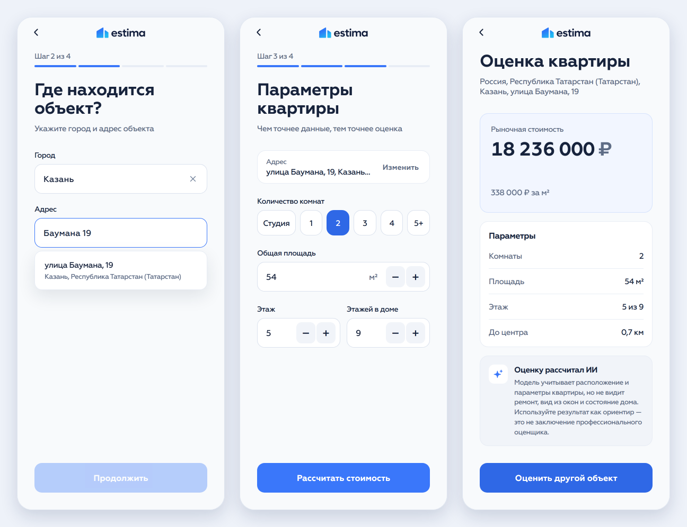
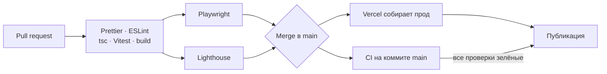
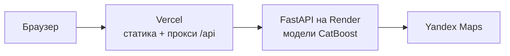

<div align="center">

# Estima · Frontend

**Оценка рыночной стоимости недвижимости в пару кликов**

Мобильный веб-клиент: выберите адрес, укажите параметры квартиры,<br>и модель машинного обучения назовёт цену по тысячам реальных объявлений

[](https://estima-frontend-six.vercel.app/)
[](https://estima-backend.onrender.com/docs)
[](https://github.com/welldanov/estima-backend)

[](https://github.com/welldanov/estima-frontend/actions/workflows/ci.yml)


</div>



<sub>Бэкенд работает на бесплатном Render и засыпает без запросов, поэтому первая оценка может занять до минуты.</sub>

## Что умеет

- **Ведёт за руку.** Четыре коротких шага: тип объекта → адрес → параметры → цена. Расчёт идёт прямо на странице результата — со скелетоном, а цена «докручивается» до итоговой.
- **Подсказывает адреса.** Подсказки Yandex появляются по мере ввода, и в них только адреса, которые модель умеет оценивать. В списке городов — только те, где есть модель для выбранного типа объекта.
- **Объясняет ошибки по-человечески.** Если адрес вне зоны покрытия или без номера дома, предложит его изменить; если сервер или сеть подвели — повторить запрос.
- **Не теряет данные.** Введённое переживает перезагрузку страницы, а готовая оценка не пересчитывается заново.
- **Сделан для телефона.** Кнопки «Далее» и «Готово» на клавиатуре переводят между полями, список подсказок не уезжает под клавиатуру, у числовых полей есть кнопки ±.
- **Доступен.** Подсказки адреса — полноценный ARIA combobox с управлением стрелками, у всех кнопок есть подписи для скринридеров, анимации отключаются при `prefers-reduced-motion`.

## Качество

Каждый pull request проходит CI, а на прод попадает только то, что его прошло.

| Проверка                         | Инструмент                | Что ловит                                                                                 |
| -------------------------------- | ------------------------- | ----------------------------------------------------------------------------------------- |
| Форматирование и линтер          | Prettier, ESLint          | стиль, ошибки React-хуков, импорты в обход архитектуры                                    |
| Типы                             | TypeScript                | ошибки типов в коде и тестах                                                              |
| Unit-тесты                       | Vitest · 46 тестов        | валидацию формы, стор, маппинг ответов API, обработку ошибок                              |
| E2E-тесты                        | Playwright · 18 сценариев | весь визард в мобильном браузере: путь до цены, ошибки 4xx/5xx, редиректы, кнопки «назад» |
| Производительность и доступность | Lighthouse                | падение скорости загрузки, контраста, подписей, SEO                                       |

Lighthouse главной страницы в мобильной эмуляции:

| Performance | Accessibility | Best Practices |   SEO   |
| :---------: | :-----------: | :------------: | :-----: |
|   **95**    |    **100**    |    **100**     | **100** |



<sub>`main` защищён: изменения только через PR с зелёным CI. Vercel переключает домен на новую сборку только после тех же проверок на коммите в `main` (Deployment Checks).</sub>

## Как это устроено



Браузер ходит только на `vercel.app`: запросы к `/api` Vercel проксирует на бэкенд. Поэтому нет CORS, а пользователю не нужен прямой доступ к Render.

Самое интересное под капотом:

- **Feature-Sliced Design.** Код разложен по слоям `app → pages → widgets → features → entities → shared`, импорт только сверху вниз. ESLint не даёт обойти слой относительным путём.
- **Одна проверка на всё.** `validateApartment` — единственный источник правды о валидности квартиры: его используют форма, защита страницы результата и запрос оценки, поэтому они не могут разойтись.
- **API в одном месте.** Бэкенд говорит на snake_case, приложение — на camelCase. Маппинг живёт только в `entities/*/api`, страницы о формате бэкенда не знают.
- **Результат всегда соответствует вводным.** Любое изменение типа, города, адреса или параметров сбрасывает сохранённую оценку — устаревшая цена не покажется.
- **Навигация без петель.** «Назад» возвращает по истории, если пользователь пришёл кнопкой визарда, и заменяет адрес, если зашёл по ссылке. Каждый шаг сам перенаправляет на недостающий.
- **Свой UI-кит без библиотек.** Поля, автокомплит, числовой ввод, кнопки — в `shared/ui`, на общих SCSS-миксинах и 23 цветовых токенах.
- **Без ручной мемоизации.** React Compiler сам расставляет оптимизации, `useMemo`/`useCallback` в коде почти не нужны.

## Стек

|                    |                                                                                                                                                                                                                                                                                                                                                                                                                                                         |
| ------------------ | ------------------------------------------------------------------------------------------------------------------------------------------------------------------------------------------------------------------------------------------------------------------------------------------------------------------------------------------------------------------------------------------------------------------------------------------------------- |
| **Приложение**     |                               |
| **Сборка**         |                                                                                                                                                                                                    |
| **Качество**       |      |
| **Инфраструктура** |                                                                                                                                                                                                                                                                |

## Запустить у себя

<details>
<summary>Показать инструкцию</summary>

Нужен Node.js 24. Для оценок локально нужен запущенный [бэкенд](https://github.com/welldanov/estima-backend) на `http://127.0.0.1:8000` — dev-сервер проксирует на него `/api`.

```bash
npm ci
npm run dev    # http://localhost:5173
```

Проверки (то же самое запускает CI на каждый pull request):

```bash
npm run format:check   # Prettier
npm run lint           # ESLint
npm run test:run       # unit-тесты (npm test — в watch-режиме)
npm run build          # проверка типов и сборка
npm run test:e2e       # E2E, сам соберёт проект; бэкенд не нужен — API замокан
```

Lighthouse локально (после `npm run build`):

```bash
npx @lhci/cli@0.15.1 autorun
```

</details>

<details>
<summary>Структура проекта</summary>

```
src/
  app/        роутер, layout с шапкой, глобальные стили и токены
  pages/      home · address · details · result — по странице на шаг
  features/   выбор типа и города, поиск адреса, стор и логика оценки
  entities/   город, адрес, оценка: типы и запросы к API
  shared/     UI-кит, клиент API, утилиты, иконки и шрифты
e2e/          сценарии Playwright и моки API
```

</details>
